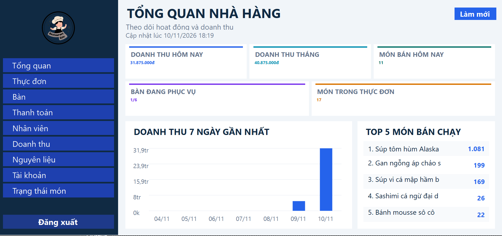
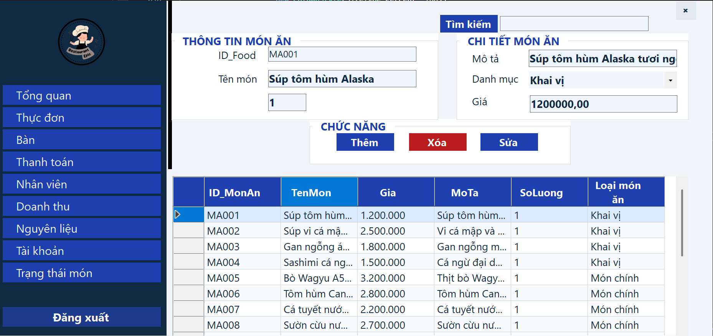
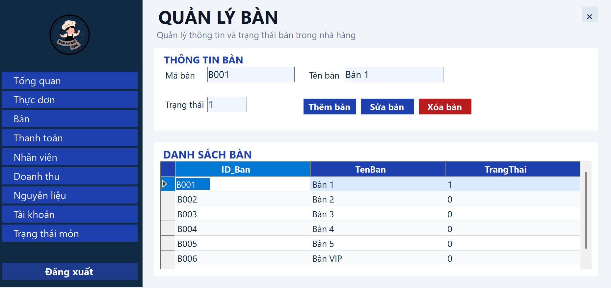
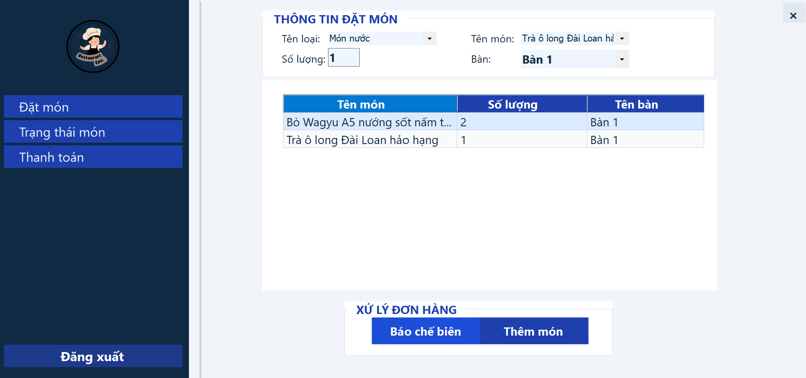
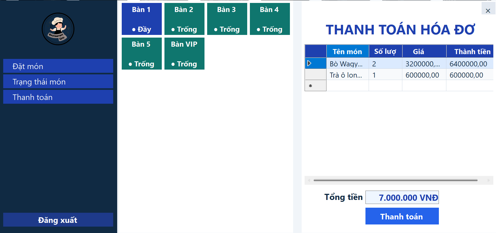
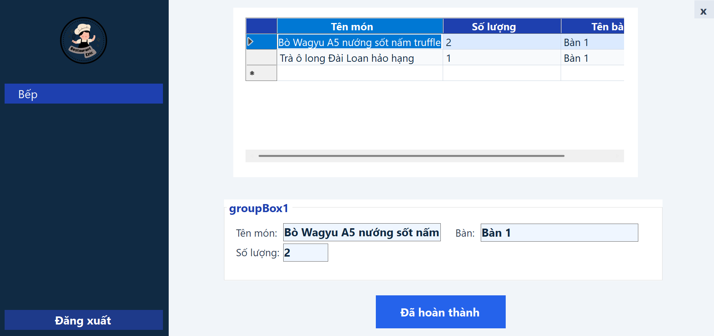
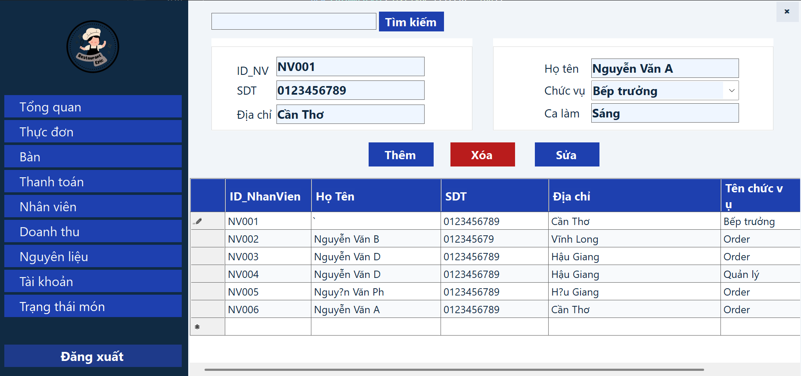
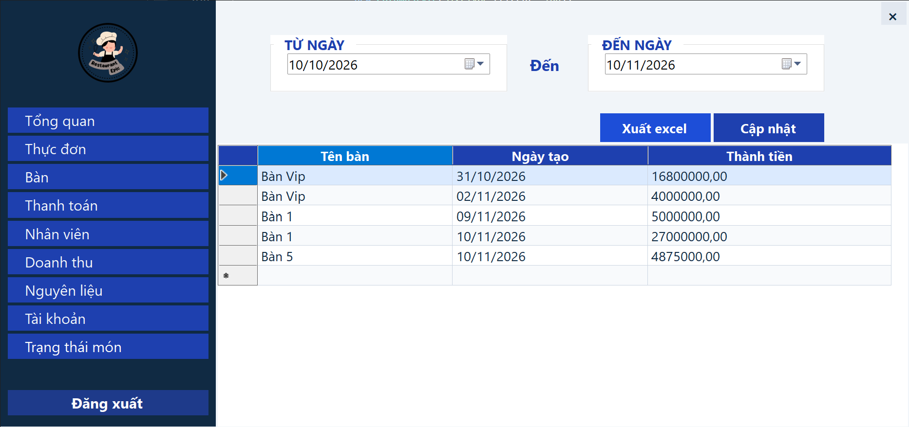
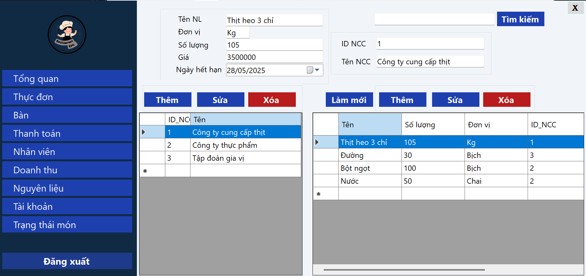
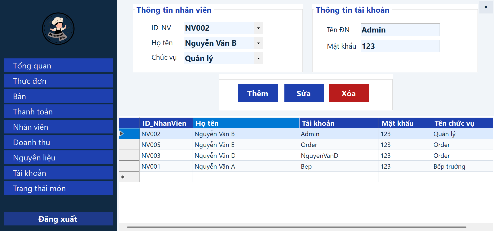

# HỆ THỐNG QUẢN LÝ NHÀ HÀNG

## Giới thiệu dự án

**Hệ thống Quản lý Nhà hàng (Restaurant Management System)** là ứng dụng desktop được xây dựng bằng **C# Windows Forms (WinForms)** và **Microsoft SQL Server**.

Ứng dụng hỗ trợ quản lý các hoạt động hằng ngày của nhà hàng, bao gồm quản lý thực đơn, bàn ăn, gọi món, thanh toán, nhân viên, nguyên liệu, tài khoản và thống kê doanh thu.

Dự án được thực hiện nhằm vận dụng kiến thức lập trình C#, thiết kế giao diện Windows Forms, xử lý dữ liệu với SQL Server và xây dựng các chức năng quản lý theo quy trình nghiệp vụ thực tế.

## Công nghệ sử dụng

| Công nghệ | Mục đích |
|---|---|
| C# | Ngôn ngữ lập trình chính |
| Windows Forms | Xây dựng giao diện ứng dụng desktop |
| Microsoft SQL Server | Lưu trữ và quản lý dữ liệu |
| ADO.NET | Kết nối và thao tác với cơ sở dữ liệu |
| ClosedXML | Xuất báo cáo doanh thu ra Excel |
| Visual Studio 2022 | Môi trường phát triển |
| Git & GitHub | Quản lý phiên bản và lưu trữ mã nguồn |

## Chức năng chính

### 1. Trang tổng quan quản trị (Admin Dashboard)

- Hiển thị doanh thu trong ngày và trong tháng.
- Thống kê số lượng món ăn đã bán.
- Theo dõi số bàn đang phục vụ.
- Thống kê tổng số món trong thực đơn.
- Biểu đồ doanh thu trong 7 ngày gần nhất.
- Hiển thị Top 5 món ăn bán chạy.

### 2. Quản lý thực đơn

- Thêm, sửa và xóa thông tin món ăn.
- Quản lý giá bán và mô tả món ăn.
- Phân loại món ăn theo danh mục.
- Tìm kiếm món ăn.

### 3. Quản lý bàn

- Hiển thị danh sách bàn trong nhà hàng.
- Theo dõi trạng thái bàn.
- Thêm, sửa và xóa thông tin bàn.

### 4. Quản lý gọi món

- Lựa chọn bàn phục vụ.
- Chọn món ăn và số lượng.
- Quản lý các món ăn khách hàng đã gọi.

### 5. Quản lý thanh toán

- Hiển thị thông tin các món ăn đã gọi.
- Tính toán tổng tiền thanh toán.
- Xử lý hóa đơn của khách hàng.

### 6. Quản lý bếp và trạng thái món ăn

- Theo dõi các món ăn được gửi đến bếp.
- Cập nhật tình trạng chế biến món ăn.
- Hỗ trợ phối hợp giữa bộ phận phục vụ và bếp.

### 7. Quản lý nhân viên

- Quản lý thông tin nhân viên.
- Thêm, sửa, xóa và tìm kiếm thông tin nhân viên.
- Quản lý thông tin chức vụ.

### 8. Thống kê doanh thu

- Xem doanh thu theo khoảng thời gian.
- Thống kê doanh thu từ dữ liệu SQL Server.
- Xuất báo cáo doanh thu ra file Excel.

### 9. Quản lý nguyên liệu

- Quản lý danh sách nguyên liệu.
- Theo dõi số lượng nguyên liệu.
- Quản lý thông tin liên quan đến nguyên liệu.

### 10. Quản lý tài khoản

- Quản lý các tài khoản sử dụng hệ thống.
- Hỗ trợ đăng nhập và phân quyền truy cập theo chức năng được cấp.

---

## Hình ảnh giao diện ứng dụng

### 1. Trang tổng quan Admin

Màn hình tổng quan giúp người quản trị theo dõi tình hình hoạt động kinh doanh của nhà hàng thông qua các chỉ số và biểu đồ thống kê.



### 2. Quản lý thực đơn

Giao diện quản lý các món ăn, danh mục, giá bán và thông tin thực đơn.



### 3. Quản lý bàn

Giao diện theo dõi danh sách bàn và tình trạng phục vụ.



### 4. Quản lý gọi món

Giao diện hỗ trợ nhân viên lựa chọn bàn, món ăn và xử lý đơn gọi món.



### 5. Quản lý thanh toán

Giao diện hiển thị hóa đơn, các món đã gọi và thông tin thanh toán.



### 6. Quản lý bếp

Giao diện quản lý các món ăn cần chế biến và theo dõi tình trạng món.



### 7. Quản lý nhân viên

Giao diện quản lý thông tin nhân sự của nhà hàng.



### 8. Thống kê doanh thu

Giao diện hỗ trợ xem báo cáo doanh thu, lọc dữ liệu theo thời gian và xuất Excel.



### 9. Quản lý nguyên liệu

Giao diện quản lý danh sách và thông tin nguyên liệu.



### 10. Quản lý tài khoản

Giao diện quản lý các tài khoản sử dụng ứng dụng.



---

## Hướng dẫn cài đặt và chạy ứng dụng

### Yêu cầu hệ thống

- Hệ điều hành Windows.
- Visual Studio 2022.
- Bộ công cụ phát triển .NET Desktop.
- Microsoft SQL Server.
- .NET Framework hoặc .NET phù hợp với cấu hình dự án.

### Các bước cài đặt

**Bước 1: Tải mã nguồn**

Mở Terminal hoặc Git Bash và chạy:

```bash
git clone https://github.com/phat102004/Restaurant-management.git
```

**Bước 2: Mở dự án**

Mở file Solution (`.sln`) bằng Visual Studio 2022.

**Bước 3: Cấu hình cơ sở dữ liệu**

- Chuẩn bị cơ sở dữ liệu SQL Server cho ứng dụng.
- Cấu hình chuỗi kết nối phù hợp với SQL Server trên máy.
- Kiểm tra các bảng dữ liệu cần thiết.

**Bước 4: Chạy ứng dụng**

- Build Solution để kiểm tra lỗi.
- Khởi chạy ứng dụng.
- Đăng nhập bằng tài khoản được cấu hình trong hệ thống.

**Lưu ý:** Ứng dụng cần kết nối SQL Server để hoạt động. Người dùng cần chuẩn bị cơ sở dữ liệu và cấu hình môi trường phù hợp trước khi chạy.

---

## Kiến thức và kỹ năng áp dụng

Thông qua dự án, tôi đã thực hành và vận dụng:

- Lập trình hướng đối tượng với C#.
- Phát triển ứng dụng desktop bằng Windows Forms.
- Thiết kế giao diện quản lý với Form và UserControl.
- Thực hiện các thao tác CRUD với cơ sở dữ liệu.
- Sử dụng SQL Server và ADO.NET.
- Xử lý dữ liệu và quy trình nghiệp vụ nhà hàng.
- Xây dựng Dashboard thống kê doanh thu.
- Xuất báo cáo dữ liệu ra Excel.
- Quản lý và cập nhật mã nguồn bằng Git, GitHub.

## Thông tin tác giả

**GitHub:** [phat102004](https://github.com/phat102004)

**Mã nguồn dự án:** [Restaurant Management System](https://github.com/phat102004/Restaurant-management)

---

*Dự án được xây dựng nhằm mục đích học tập, thực hành và phát triển kỹ năng lập trình ứng dụng quản lý.*
